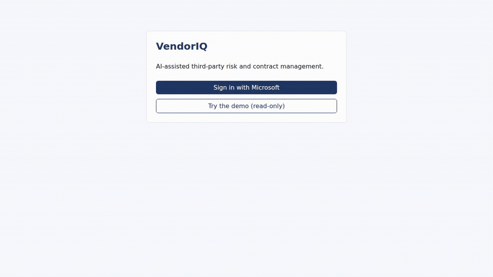
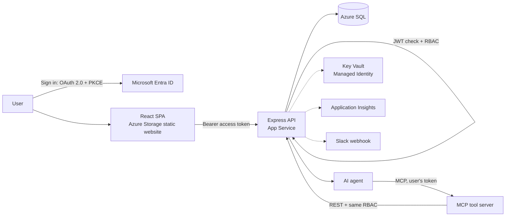

# VendorIQ — AI-assisted third-party risk & contract management

Secure full-stack app for procurement teams: Microsoft Entra ID single sign-on with role-based access,
a REST API on SQL Server / Azure SQL, sourcing (RFx) bid comparison, and an AI agent that answers
questions by calling tools through an MCP server, always with the signed-in user's own permissions.

> **Live demo:** https://stvendoriqjr3311.z9.web.core.windows.net (click "Try the demo", no account needed)



[](https://github.com/jamierowe15/vendoriq/actions/workflows/ci-cd.yml)

## Architecture



The API is the security boundary: every path, including the agent's tool calls, passes JWT
validation and role checks before reaching SQL.

## Features

- Vendors, contracts and risk assessments, with search and contracts-expiring reports
- Microsoft Entra ID SSO with three app roles:

  | Role | Read | Create / edit / flag vendors | Offboard vendors, award RFx |
  | --- | :---: | :---: | :---: |
  | `Procurement.Viewer` | ✅ | ❌ | ❌ |
  | `Procurement.Analyst` | ✅ | ✅ | ❌ |
  | `Procurement.Admin` | ✅ | ✅ | ✅ |

- RFx (sourcing) module: bids ranked by a transparent 60% price / 40% risk score
- AI assistant: LLM tool calling through a Model Context Protocol (MCP) server with 7 tools
- Slack alerts when a vendor is flagged or an RFx is awarded; full audit log
- Optional read-only public demo mode

## Security decisions

- JWT validated on every request: signature (Entra JWKS), issuer, audience, expiry and scope
- RBAC enforced in the API, not just hidden in the UI
- Parameterized SQL only; zod input validation; rate limiting; helmet security headers
- Soft deletes and an audit trail of every write
- Least-privilege database user (read/write data, no schema changes)
- Secrets in Key Vault via Managed Identity; GitHub deploys with OIDC (no stored passwords)
- The AI agent forwards the user's token, so it can never exceed the user's access; write tools
  are hidden from users who can't use them; tool output is treated as data, not instructions

## Testing & CI/CD

26 Jest/Supertest tests cover authentication (401), authorization for all three roles (403),
validation (400), RFx scoring, demo mode and error handling. They use a fake token checker and a
mocked database, so they run in CI with no Entra ID or SQL Server. Every push runs the tests,
`npm audit` and a frontend build; deploys to Azure run only when the tests pass.

## Run locally

Requirements: Node.js 22, SQL Server Express, SSMS.

1. In SSMS run `database/01-login.sql`, `02-schema.sql` and `03-seed.sql`.
2. `cd server && cp .env.example .env` and fill in the values, then `npm install && npm run dev`.
3. `cd client && cp .env.example .env.local` and fill in the values, then `npm install && npm run dev`.
4. Open http://localhost:5173.

## Project structure

```
database/        SQL scripts (local and Azure)
server/src/
  app.js         Express app: security middleware and routes
  middleware/    auth.js (JWT + roles), validate.js (zod, ids)
  routes/        vendors, contracts, rfx, agent
  mcp/server.js  MCP tool server used by the AI agent
server/tests/    Jest + Supertest security tests
client/src/      React (Vite) app with MSAL sign-in
.github/workflows/ci-cd.yml
```

## Tech stack

React, Vite, Node.js, Express, SQL Server / Azure SQL, Microsoft Entra ID (MSAL), Azure App Service,
Azure Storage static website, Key Vault, Application Insights, Model Context Protocol, OpenAI / Azure OpenAI,
Jest, Supertest, GitHub Actions.
