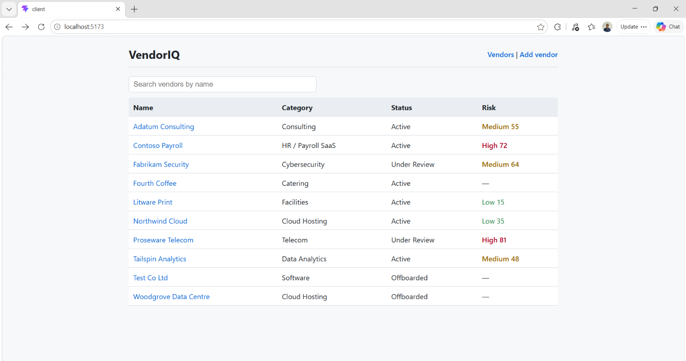
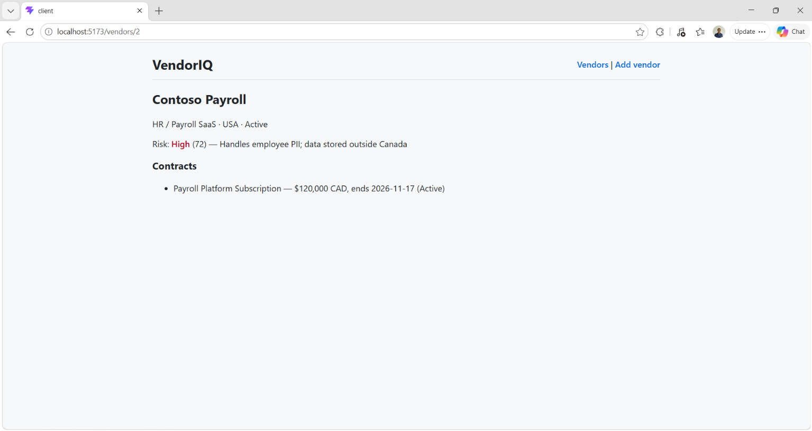

# VendorIQ — Third-Party Risk & Contract Management Platform

VendorIQ helps procurement and vendor-risk teams track third-party vendors, their contracts,
and their risk scores — with secure sign-in, role-based access, a full audit trail, and an
AI assistant that can answer questions about the vendor portfolio.

It's modelled on the tools a bank's sourcing, contracting and third-party risk teams use.

> **Build status:** ✅ done · 🚧 in progress
> Portfolio project, built in stages. See [Progress](#progress) for what's live today.

---

## Progress

| Area | What it covers | Status |
|---|---|---|
| Database | SQL Server schema, seed data, joins, audit table | ✅ |
| REST API | Express CRUD, reports, validation, security middleware | ✅ |
| React frontend | Vendor list with search, vendor detail, add-vendor form | ✅ |
| SSO & RBAC | Microsoft Entra ID sign-in, app roles, protected API | 🚧 |
| Azure | App Service, Azure SQL, Key Vault, Managed Identity, App Insights | 🚧 |
| AI / MCP | MCP server exposing vendor tools to an AI assistant, human approval step | 🚧 |
| Quality | Automated tests, GitHub Actions CI/CD | 🚧 |

---

## Features

### Vendor & contract management
- ✅ Create, view, update and offboard vendors
- ✅ Vendor detail with all contracts and latest risk assessment, loaded in one database round trip
- ✅ "Contracts expiring in N days" report, joined with vendor risk level
- ✅ Soft delete — offboarded vendors are kept for audit, never erased
- ✅ React UI with live search, colour-coded risk levels and validated forms

### Security
- ✅ Schema validation on every write (zod) with field-level 400 errors
- ✅ Parameterized SQL queries — verified against SQL-injection test cases
- ✅ Helmet security headers, rate limiting, CORS allow-list, request size limits
- ✅ Central error handler that never leaks stack traces
- ✅ Secrets kept out of source control (`.env`, `.gitignore`)
- 🚧 Single Sign-On with Microsoft Entra ID (MSAL in React, JWT validation in Express)
- 🚧 Role-based access: **Viewer** (read), **Analyst** (create/update), **Admin** (offboard)
- 🚧 Secrets in Azure Key Vault, accessed through a Managed Identity

### Audit & compliance
- ✅ Every create, update and offboard written to an `AuditLog` table (who, what, which record, when)
- 🚧 Signed-in user's email recorded automatically once SSO is live

### AI assistant (MCP)
- 🚧 Model Context Protocol server exposing tools such as `search_vendors`, `get_vendor`, `expiring_contracts`
- 🚧 Agentic workflow: the assistant can *propose* a risk-level change, which an Analyst must approve before it's saved
- 🚧 AI calls go through the same authenticated, audited API as the UI

### Cloud & operations
- 🚧 Deployed to Azure App Service with Azure SQL Database
- 🚧 Application Insights for request logging, errors and health monitoring
- 🚧 GitHub Actions pipeline: install → test → deploy on push to `main`

---

## Architecture

```
React (Vite)  ──HTTPS──▶  Express REST API  ──▶  SQL Server / Azure SQL
     │                        │    │
     │ MSAL sign-in           │    └──▶ AuditLog
     ▼                        ▼
Microsoft Entra ID      JWT + role checks

AI assistant ──MCP──▶ VendorIQ MCP server ──▶ Express API (same auth & audit)
```

---

## Tech stack

| Layer | Technology |
|---|---|
| Frontend | React, Vite, React Router |
| Backend | Node.js, Express 5 |
| Database | Microsoft SQL Server (local), Azure SQL Database (cloud) |
| Security | zod, Helmet, express-rate-limit, Microsoft Entra ID, MSAL |
| Cloud | Azure App Service, Key Vault, Managed Identity, Application Insights |
| AI | Model Context Protocol (MCP) |
| Testing & CI | Postman, Jest, Supertest, GitHub Actions |

---

## API

| Method | Endpoint | Purpose | Role (with SSO) | Status |
|---|---|---|---|---|
| GET | `/api/health` | Health check | Public | ✅ |
| GET | `/api/vendors?search=` | List / search vendors with risk level | Viewer | ✅ |
| GET | `/api/vendors/:id` | Vendor + contracts + risk | Viewer | ✅ |
| POST | `/api/vendors` | Create vendor | Analyst | ✅ |
| PUT | `/api/vendors/:id` | Update vendor | Analyst | ✅ |
| DELETE | `/api/vendors/:id` | Offboard vendor (soft delete) | Admin | ✅ |
| GET | `/api/contracts/expiring?days=60` | Contracts ending soon | Viewer | ✅ |

Error responses: `400` invalid input · `401` not signed in · `403` wrong role · `404` not found · `429` rate limited · `500` server error

---

## Database

Tables: `Vendors`, `Contracts`, `RiskAssessments`, `AuditLog`
Scripts: `database/schema.sql` (tables, constraints) and `database/seed.sql` (sample data).
The app connects with a least-privilege SQL login (read/write only — no schema changes).

---

## Run locally

**Prerequisites:** Node.js 20+, SQL Server Express, SSMS

```bash
# 1. Database — run in SSMS
database/schema.sql
database/seed.sql

# 2. API
cd server
npm install
# create server/.env (see below)
npm run dev          # http://localhost:4000/api/health

# 3. Frontend (new terminal)
cd client
npm install
npm run dev          # http://localhost:5173
```

`server/.env` example:
```
PORT=4000
DB_SERVER=localhost\SQLEXPRESS
DB_NAME=VendorIQ
DB_USER=vendoriq_app
DB_PASSWORD=<your-password>
CLIENT_ORIGIN=http://localhost:5173
```

---

## Testing

- ✅ Postman collection covering CRUD, validation (400), not-found (404), and a SQL-injection attempt
- 🚧 Automated API tests with Jest + Supertest, run in GitHub Actions on every push

---

## Screenshots

**Vendor list** — live search and colour-coded risk levels



**Vendor detail** — contracts and latest risk assessment



---

## What I learned
- Designing REST APIs with correct status codes and input validation at the boundary
- Preventing SQL injection with parameterized queries, and proving it with tests
- Building audit trails and soft deletes for regulated environments

---

## Author
**Jamie Rowe** — Toronto, ON
Diploma, Computer Systems Technician – Networking (Centennial College)
